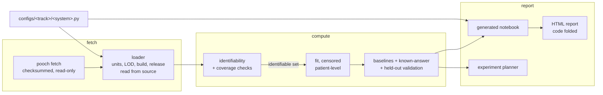

# Spatiotemporal Disease Modeling

Statistical and mechanistic models that connect wet-lab measurements to public multi-omics,
biostatistics and epidemiology resources. Written for two readers at once: the bench
scientist who generated the data and wants to know what it means, and the modeller who
needs to know whether the numbers can be trusted.

The project is organised as connected tracks that share one statistics core. Each track
starts from something a wet-lab researcher already has, such as a tissue image, a viral time
course, antibody titers or a gene of interest. Each one links that data to public databases
and published methods.

Full map of tracks, databases, identifiers and bridges: [docs/scope-map.md](docs/scope-map.md).

## The shared core

Every analysis in every track answers these questions in order:

1. **Can this data constrain this model at all?** Identifiability is checked before fitting.
   A parameter the data cannot pin down is reported as unidentifiable, not as a number.
2. **Are the measurement's limits respected?** Values below the limit of detection enter as
   censored observations, never as LOD/2. Thresholds are derived from the data and scanned,
   never tuned against the answer.
3. **Is the replicate the right unit?** Patients, animals or donors are the unit of
   replication, never cells, spots or regions.
4. **Does it beat a model that knows nothing?** Every result is shown next to a no-information
   baseline.
5. **Does it recover a known answer?** Every method is run first on synthetic data with known
   parameters, which shows how much the method can resolve at all.
6. **What should the next experiment be?** The fitted model simulates candidate designs and
   ranks them by how much they would narrow the remaining uncertainty.

## Tracks

| Track | Wet-lab starting point | Public data it connects | Built on |
|---|---|---|---|
| **A. Tissue dynamics from a snapshot** | Multiplexed tissue image with Ki67 | Danenberg and Fischer breast-cancer IMC (Zenodo, open); TCGA, METABRIC | OSDR (Somer, *Nature* 2025); Voyager; Gulati 2024 |
| **B. Infection inside one host** | Viral titers or Ct over time | DSAIRM challenge data; Kissler Ct trajectories; Beauchemin TCID50; GEO challenge transcriptomes | DSAIRM (Handel 2020); identifiability (Tuncer 2025; Simpson & Baker 2026) |
| **C. Antibody kinetics and protection** | Antibody titers before and after exposure | Handel group HAI cohorts; CMI-PB; ImmPort | serosolver (Hay 2020); Khoury 2021 |
| **D. From hosts to populations** | Surveillance Ct values, serosurveys | EPI-Eval (Hugging Face); serosurveys | virosolver (Hay 2021); PyRenew; serofoi |
| **E. Variant to cell type to tissue** | A gene, variant or animal model | GWAS Catalog, gnomAD, ClinVar, GTEx, Roadmap/ENCODE, UCSC, CELLxGENE, Human Protein Atlas | Muus 2021; Chaffin 2022; Bravo González-Blas 2024 |
| **F. Experiment planner** | A planned experiment, or a 3D image and a sequencing budget | Fitted models from A–E | CPA (Lotfollahi 2023); scMultiSim (2025); DISCO-seq (Bhatia 2025) |

Bridges between tracks are where most of the new work is. For example:
- Receptor-positive cell fractions from CELLxGENE fix the starting target-cell count in the
  infection model (E → B).
- Within-host Ct trajectories become the measurement model for population Ct inference (B → D).

Each track ships as its own release and is complete on its own. Track-level plans:
- Track A: [docs/roadmap.md](docs/roadmap.md)
- Track B notebooks: [docs/notebook-design.md](docs/notebook-design.md)
- Whether one real disease system can carry all six tracks, and what was verified against
  the live data records: [docs/case-study-selection.md](docs/case-study-selection.md).
  Short answer: none can, and in two candidates the gap is biological rather than a
  missing dataset.

## Architecture



Fetch, compute and report are separate stages, each cached to disk. Notebooks are generated
from one config per system and are build output, never source. Analysis code is identical
across the systems in a track.

## Install

```
conda env create -f environment.yml
conda activate spatiotemporal
python tools/install_kernel.py           # needed before opening the notebook
python tools/make_notebook.py            # write notebooks/scope_map_walkthrough.ipynb
python tools/make_notebook.py --execute  # also run it and keep the outputs
```

The kernel step is not optional on Windows. NumPy delay-loads its BLAS library from the
environment's `Library\bin`, Windows resolves delay-loaded DLLs through PATH, and
launching `python.exe` without activating the environment leaves that directory off PATH.
The load then aborts the process instead of raising, so the kernel dies on the first cell
with no traceback and a front end reports only "the kernel died". In VS Code, pick the
kernel **Python (spatiotemporal)**. See [docs/kernel-setup.md](docs/kernel-setup.md).

The environment is a single conda-forge `environment.yml` with a reason for every pin.
Downloads are cached outside OneDrive, in the directory named by the `SPATIOTEMPORAL_CACHE`
environment variable (default `~/.cache/spatiotemporal`).

## Data access

Raw data is fetched at run time, checksummed and never committed. Restricted datasets are
never stored in or published from this repository.

| Dataset | Track | Access |
|---|---|---|
| Danenberg 2022 METABRIC IMC (Zenodo 7324285) | A | Open, CC BY 4.0 |
| Fischer 2023 IMC (Zenodo 7494509) | A | Open, CC BY 4.0, ~39 GB |
| Wang 2023 NeoTRIP IMC (Zenodo 7990870) | A | Restricted: application, academic non-commercial. Optional |
| Hayden 1996 influenza, via DSAIRM | B | GPL-3 package. 27 rows of **group daily averages digitised from a figure**, not per-subject series |
| Kissler 2021 Ct, `gradlab/CtTrajectories` | B, D | **No license** (GitHub reports none; same for `CtTrajectories_Omicron`) |
| Rendeiro 2021 COVID-19 lung IMC (Zenodo 4110560 raw / 4139443 processed) | A | Open. Raw CC BY 4.0; **processed CC BY-NC 4.0**. Code repo `ElementoLab/covid-imc` has no license |
| Simon 2016 in vitro, `cbeauc/mfm_ed_iv` | B | GPL-3 |
| Handel group HAI cohorts | C | AGPL-3; some repos have no license and are not used |
| GTEx, gnomAD, GWAS Catalog, ClinVar, CELLxGENE, HPA | E | Open, release recorded with every result |
| Chaffin 2022 heart atlas (Single Cell Portal SCP1303) | E | Processed data open; raw data controlled (dbGaP) |

## Pitfalls known before starting

These come from the literature, not from this repository's runs. Each will be checked and
replaced by what was actually seen.

**Measurement**
- Substituting LOD/2 for censored values biases decay rates (Handel group, *Vaccine* 2025).
- Ct is not viral load without the lab's own standard curve. TCID50 is not a count of
  virions.
- Ki67 marks a window of the cell cycle, not a division event. The window length sets OSDR's
  time axis.

**Identifiability**
- From viral load alone, virion production p and the starting target-cell count T0 are not
  separately identifiable. Rescaling (p, T0) to (p/k, kT0) leaves the viral-load curve exactly
  unchanged, so only the product p·T0 is constrained. The notebook demonstrates this.
- In OSDR, the death rate is assumed rather than observed. Death that depends on
  neighbourhood cannot be identified from Ki67 alone.

**Replication**
- Counting cells as n inflates significance. OSDR reports P < 10⁻¹³ from cells when about 50
  patients per group are the real replicates. Muus et al. (*Nat Med* 2021) saw two effects
  reverse under leave-one-dataset-out testing.

**Joins**
- The same ID string in two studies is not the same patient.
- GRCh37 and GRCh38 variant positions differ.
- Cell-type labels from different atlases are not interchangeable.

**Annotation vs validation**
- None of the papers behind this project used GWAS Catalog or gnomAD to validate a result.
  Here they are used for annotation and prioritization only.

## Open decisions

- **Bayesian backend on Windows.** PyMC, NumPyro with diffrax, or emcee around SciPy. Each
  needs a check that its conda-forge Windows build works, plus a short benchmark, before it is
  pinned.
- **Structural identifiability tool.** The mature tools are Julia (SIAN,
  StructuralIdentifiability.jl). Options are calling Julia and recording the result, or relying
  on profile likelihood alone.
- **OSDR reference package.** `JonathanSomer/osdr` (Python ≥ 3.10, Apache-2.0 per its README
  badge) has not yet been tested on Windows.

## Status

**Track A has its first run against real data.** 31 checks, 2 FAIL, run 2026-10-28 on
Rendeiro et al. 2021 COVID-19 lung IMC (Zenodo 4139443): 664,006 cells, 237 ROIs,
23 patients, seed 20261028. Software: Python 3.11.17, NumPy 2.3.5, SciPy 1.17.1,
h5py 3.16.0, Windows 11, CPU only.

The two failures are results, not defects, and both are recorded below. The pipeline's
positive control passes: synthetic data with known rules recovers every intercept and
neighbour weight to within 1.47 standard errors over 30 parameters, and produces the
interior fixed point that the real data does not.

Reproduce with:

```
python tools/fetch_imc_centroids.py
python tools/track_a_real_data.py --h5ad <path to covid-imc.h5ad>
```

Tracks B to F remain at design stage: no fits, no results.

## Negative results and overturned conclusions

**1. Cleaved caspase-3 does not act as a death marker in this dataset, so the two-marker
fix for OSDR does not apply to it.**

*Believed:* OSDR cannot identify removal from a division marker alone, and this project's
synthetic work showed that adding a death marker fixes it (0 of 20 simulated studies
failed with two markers against 18 of 20 with Ki67 alone). The Rendeiro panel carries both
Ki67 and cleaved caspase-3, which is why it was proposed as Track A's reference system in
[docs/case-study-selection.md](docs/case-study-selection.md).

*What showed it was wrong:* mean cleaved caspase-3 is **0.40** in the authors' own
"Dying cells" cluster but **0.62** in macrophages and **0.57** in neutrophils. The marker
tracks myeloid identity more strongly than apoptosis here, and no cell in the "Dying cells"
cluster exceeds the 99th percentile of the rest. Using it as the removal rate gives an
interior fixed point in **0 of 23** patients.

*What replaced it:* the presence of a death marker in a panel is not evidence that it
measures death. A marker must be shown to separate the population it names before it can
identify a rate. The scope map's claim that Ki67 plus a death marker resolves OSDR's
identifiability gap now holds only for the synthetic case where that separation is true by
construction.

**2. OSDR's coexistence fixed point does not exist in this tissue, and the real data does
worse than shuffled labels.**

*Believed:* fitting P(dividing | neighbourhood) per cell type would yield a weight matrix
whose interior fixed point describes the tissue's steady state.

*What showed it was wrong:* an interior fixed point exists in **1 of 23** patients, while
permuting the division labels within a patient produces one in **26%** of refits. Real
tissue therefore scores *below* its own null. The result is stable across the cuts:
1/23, 1/23 and 3/23 at 15, 25 and 40 um, and 0/23, 1/23 and 5/23 at the top 2%, 5% and 10%
of Ki67. The same pipeline recovers a fixed point from synthetic data with known rules, so
this is the data, not the code.

*What replaced it:* OSDR assumes the sampled tissue is at steady state. These are autopsy
lungs from acute respiratory failure, which is the opposite. The mean Ki67+ fraction rises
from 2.8% in healthy lung to 5.1% in COVID-19 and 9.0% in ARDS, so the tissue is
measurably not in balance. A snapshot method that assumes stationarity should not be
applied to acute disease tissue without first testing that assumption; this run is that
test, and it fails.

*Caveat on scope.* Cell typing here is max-marker gating on five lineage markers
(Keratin8/18, CD31, CD68, CD3, MPO), chosen to be independent of Ki67 and caspase-3, and
agreeing with the published labels for 63% to 96% of cells depending on the type. A
faithful reproduction of the authors' 18-cluster typing could change the weight matrix.
Findings 1 and 3 do not depend on that choice; finding 2 does.

**3. The published cell-type labels cannot be used for a per-type division model.**

*Believed:* the authors' `metacluster_label` gives cell types that a division model can
condition on.

*What showed it was wrong:* "Proliferating cells" is a **state** cluster of 9,815 cells
with mean Ki67 2.15 against -0.07 elsewhere. Dividing cells of every lineage are pooled
into it, so their lineage is destroyed. Asking what fraction of macrophages divide returns
approximately zero by construction, because the Ki67-high macrophages were removed from the
macrophage cluster. A further 22.3% of cells carry the literal label `'nan'`.

*What replaced it:* typing must come from lineage markers chosen independently of the state
marker being modelled. Published clusterings that mix type and state are circular for this
purpose, however good they are for the paper that produced them.

## Key references

- Somer J, Mannor S, Alon U. Temporal tissue dynamics from a spatial snapshot. *Nature* 2025.
  doi:10.1038/s41586-025-09876-1
- Handel A, et al. A software package for immunologists to learn simulation modeling.
  *BMC Immunol* 2020. doi:10.1186/s12865-019-0321-0
- Tuncer N, Martcheva M, Ciupe SM. Structural and practical identifiability of within-host
  models of virus dynamics. *Curr Opin Syst Biol* 2025. doi:10.1016/j.coisb.2025.100552
- Simpson MJ, Baker RE. Parameter identifiability, parameter estimation, and model prediction
  for differential equation models. *SIAM Rev* 2026. doi:10.1137/24m1667968
- Gulati GS, et al. Profiling cell identity and tissue architecture with single-cell and spatial
  transcriptomics. *Nat Rev Mol Cell Biol* 2025. doi:10.1038/s41580-024-00768-2
- Muus C, et al. Single-cell meta-analysis of SARS-CoV-2 entry genes across tissues and
  demographics. *Nat Med* 2021. doi:10.1038/s41591-020-01227-z
- Chaffin M, et al. Single-nucleus profiling of human dilated and hypertrophic cardiomyopathy.
  *Nature* 2022. doi:10.1038/s41586-022-04817-8
- Hay JA, et al. An open source tool to infer epidemiological and immunological dynamics from
  serological data: serosolver. *PLoS Comput Biol* 2020. doi:10.1371/journal.pcbi.1007840
- Lotfollahi M, et al. Predicting cellular responses to complex perturbations in
  high-throughput screens. *Mol Syst Biol* 2023. doi:10.15252/msb.202211517
- Bhatia HS, et al. DISCO-seq: 3D single-cell transcriptomics of intact biological systems.
  *bioRxiv* 2025. doi:10.64898/2025.12.10.693352 (preprint, CC-BY-NC-ND; no data or code
  availability statement found in the manuscript text). Motivates the imaging-guided sampling
  question in Track F1, and marks where this project's scope ends: it begins at a segmented,
  phenotyped cell table
- Singh V, et al. Knock-in Kcnh2 rabbit model of long QT syndrome type-2, epilepsy, and sudden
  death. *J Transl Med* 2025. doi:10.1186/s12967-025-06382-w
