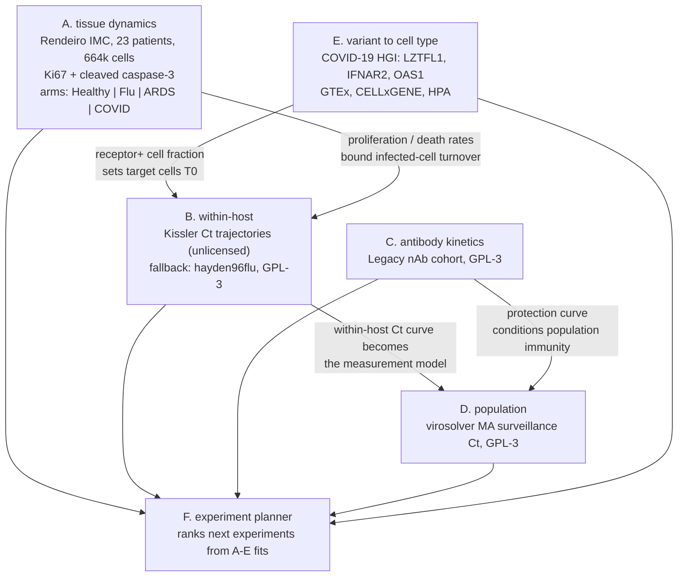

# Choosing a case study to run through all six tracks

**Status: decision document, partly superseded by its own test.** The recommendation
below was acted on: Track A was run against the Rendeiro data on 2026-10-28, and the
argument that decided it did not survive. See **What the run did to this document** before
relying on anything here. The scorecard and the licence findings still stand.

## The question

Can one real disease system carry every track (A–F), so that a wet-lab reader follows a
single story from tissue to population instead of six unrelated demonstrations?

## Verdict

**No system spans all six tracks with open data.** Every candidate fails at least one
track, and in two cases the failure is biological rather than administrative.

The recommendation is **SARS-CoV-2 as a thematic spine** with the comparison arms that
come free inside the Track A dataset — not a single cohort followed through six
analyses, because no such open cohort exists.

## What was verified directly

Checked on 2026-10-27 against the live records, not taken from secondary summaries. These
are the claims this document relies on.

| Claim | Result |
|---|---|
| Zenodo 4139443 (processed IMC) licence | **CC BY-NC 4.0** — *not* CC BY 4.0 |
| Zenodo 4110560 (raw IMC) licence | CC BY 4.0 |
| 4139443 contents | 237 mask `.tiff` + 1 `.h5ad`, **0.95 GB total** |
| `covid-imc.h5ad` | sha256 `026334e9…cef1a28`, 342.5 MB, 664 006 cells × 43 features |
| Ki67 in panel | `Ki67(Er168)` present |
| Death marker in panel | `CleavedCaspase3(Yb172)` present |
| Viral antigen in panel | `SARSCoV2S1(Eu153)` present |
| Replicate unit | 23 patients, 237 ROIs, one sample per patient |
| Disease groups | Healthy 4, FLU 2, ARDS 7, COVID19 10 |
| Phenotype groups | Healthy, Flu, ARDS, Pneumonia, COVID19_early, COVID19_late |
| Annotated cell types | 18 metaclusters, including **"Proliferating cells"** and **"Dying cells"** |
| Spatial centroids in the h5ad | **ABSENT** — no `obsm['spatial']`, no x/y in `obs` |
| Centroids recoverable from masks | **Yes** — 1422/1422 `obj_id` resolved for ROI `20200609_ARDS_1921-01` |
| `ElementoLab/covid-imc` code licence | **none** |
| `gradlab/CtTrajectories` licence | **none** (also `CtTrajectories_Omicron`) |
| `ushr` (HIV within-host) on CRAN | **archived 2026-05-14**, maintainer email undeliverable; archive copies still fetchable |
| McCaffrey TB MIBI (Mendeley `dr5fkgtrb6`) | **CC BY 4.0**, Stanford University |

### The centroid question, settled

This was the gate for Track A. The h5ad has `obsm` keys `X_pca` and `X_umap` only, and
`obs` carries no coordinates. Centroids must be recomputed from the published masks.

Tested on one ROI by joining mask labels to `obj_id`:

```
mask shape        (1000, 1000) uint16
mask labels       1827  (range 1..1853)
h5ad cells        1422  (obj_id range 2..1849)
obj_id in mask    1422 / 1422      <- complete
labels dropped    405              <- segmented but filtered out of the table
area cross-check  pearson r = 0.9908
recovered extent  y 6.5..994.9, x 5.1..994.7
```

Three consequences:

- **The join works**, and `obj_id` is the key. 237 masks × `bincount` centroids is a
  bounded preprocessing step, roughly 5 minutes of download plus a short vectorised pass.
- **`obj_id` is not a row index.** About 22% of mask labels per ROI were filtered after
  segmentation. Centroids must be left-joined onto the table, never positionally aligned.
- **`X` is scaled, not raw.** The stored `area` feature has mean 0.05 against 95.61 mask
  pixels — the same objects (r = 0.99) on a transformed scale. Do not read `X` as raw ion
  counts.

### Data-quality defects found while checking

Worth recording because each is an instance of a rule in the root `CLAUDE.md`.

- `clinical_annotation.csv` has colliding column names differing only in case
  (`lesions:Abscess` / `lesions:abscess`), which breaks case-insensitive CSV readers
  outright. Parse it case-sensitively.
- Sample `20200722_COVID_28_EARLY` is annotated `phenotypes = COVID19_late`. The name and
  the label disagree; the label should win, but the disagreement must be surfaced, not
  silently resolved. This is §2's "the same identifier doesn't mean the same sample".
- `acquisition_date` is stored as a float near 7.3054 in an undocumented encoding. It is
  not a usable date.
- `metacluster_label` includes a literal `'nan'` category. Unassigned cells are a real
  category here, not missing data to drop quietly.

## Scorecard

Open-data readiness per track, 1–5. Track F is a planner built on whatever A–E produce,
so it scores 5 wherever anything upstream works.

| System | A tissue | B within-host | C antibody | D population | E variant | Note |
|---|---|---|---|---|---|---|
| **SARS-CoV-2** | **3** | 2 | 4 | 5 | 4 | only system where no track is impossible |
| Tuberculosis | **5** | 1 | 1 | 4 | 4 | Track C fails on biology |
| Influenza | 1 | 5 | 4 | 5 | 3 | Track A fatal: n=2, no Ki67 in its own panel |
| HIV | 1 | **5** | 2 | 4 | **5** | no open Track A |
| TNBC | **5** | 1 | 0 | 4 | 4 | Tracks B and C do not exist |

Two failures are structural, not fixable by finding better data:

- **Tuberculosis has no accepted antibody correlate of protection.** Track C cannot be run
  on TB with any dataset, open or gated.
- **TNBC has no within-host infection kinetics and no antibody protection endpoint.**
  Tracks B and C are category errors for a tumour.

## Recommendation: SARS-CoV-2 spine with built-in comparison arms

SARS-CoV-2 wins not because any single track is best — TB's Track A is stronger — but
because it is the only candidate where **no track is impossible**. Its one weak point,
Track B, is a licence gap rather than a data gap.

The argument that decided it, **now falsified**: the Rendeiro panel contains Ki67 *and*
cleaved caspase-3, and this project's synthetic work had shown that Ki67 alone leaves the
OSDR fixed point undefined (18 of 20 studies) while two markers fixed it (0 of 20). The
panel appeared to supply exactly the configuration shown to be necessary.

Running it showed that a marker's presence in a panel is not evidence that it measures
what it is named after. Cleaved caspase-3 is higher in macrophages (0.62) and neutrophils
(0.57) than in the authors' own "Dying cells" cluster (0.40). It does not identify
removal here, and the two-marker argument does not transfer from the synthetic case. The
annotation of "Proliferating cells" and "Dying cells" as cell types turned out to be a
liability rather than a bonus: they are state clusters that destroy lineage.

A single case study would also break rule §1, "generalize only across systems". The same
dataset resolves that too: it carries **Healthy, Flu, ARDS and COVID-19 arms measured on
one panel by one instrument**. That is the cleanest possible generalisation test — three
comparison systems with the assay held fixed, which is far better than three systems from
three papers with three panels.



### Track assignment under this spine

| Track | Dataset | Licence | State |
|---|---|---|---|
| A | Rendeiro IMC, Zenodo 4139443 + masks | CC BY-NC 4.0 | **run 2026-10-28**; centroids derived, join complete, OSDR fixed point absent (see README) |
| B | Kissler `gradlab/CtTrajectories` | **none** | usable only after the authors clarify |
| B (fallback) | `hayden96flu` via DSAIRM | GPL-3 | group daily averages, **not** per-subject |
| C | Legacy neutralising-antibody cohort | GPL-3 | reported, not re-verified here |
| D | virosolver Massachusetts Ct | GPL-3 | reported, not re-verified here |
| E | COVID-19 HGI release 7 | open | reported, not re-verified here |
| F | fits from A–E | — | no external data |

## The honest caveat

**The tracks never share individuals.** The autopsy donors in Track A, the tested athletes
in Track B, the serology cohort in Track C and the surveillance populations in Track D are
disjoint people. No open resource links tissue, viral kinetics and serology in the same
individuals; that exists only behind controlled access.

So the spine is a **coherent disease story across six scales**, not one cohort followed
through six analyses. The notebook must say this in plain words wherever a bridge arrow is
drawn, or it will imply a mechanistic link that the data cannot support. A reader who
believes the arrows are cohort-level joins has been misled by the figure.

This is also why the recommendation is weaker than it first appears, and why keeping the
present six-reference-system design remains defensible: that arrangement never implied a
shared cohort in the first place.

## Known corrections this forces elsewhere

- `README.md` lists Kissler's licence as "License unverified". It is **absent**, which is
  a stronger statement.
- `docs/scope-map.md` §B named the Hayden 1996 challenge data without saying it is 27 rows
  of group daily averages digitised from a figure. Any per-subject fitting plan built on it
  is wrong regardless of which spine is chosen. Corrected in place.
- `README.md` Track A currently points at Danenberg and Fischer breast-cancer IMC. Adopting
  this spine would replace that; leaving it would keep Track A on a system where Tracks B
  and C cannot exist.
- `environment.yml` gained `h5py` and `pandas`, required to read the IMC table.

## If the spine is adopted

In order, each step cheap enough to abandon:

1. Pull the 237 masks (0.62 GB, about 5 min) and build a `(roi, obj_id) -> (x, y)` table
   through the checksummed fetch layer. Record the Zenodo DOI and access date.
2. Assert the join covers 100% of cells per ROI, as it did on the tested ROI, and fail
   loudly where it does not.
3. Re-run the existing Track A known-answer checks on the real panel, using Ki67 and
   cleaved caspase-3 as the two markers, with patients as the replicate unit (n = 23).
4. Report the OSDR result next to the no-information baseline for each of the four arms
   separately before comparing them.
5. Only then decide whether Track B leads with the unlicensed Ct data or the licensed flu
   data.

Step 3 was the one that mattered, and it failed, exactly as this paragraph anticipated:
the two-marker OSDR fit produced an interior fixed point in 1 of 23 patients against a
label-shuffled null of 26%. That is recorded in the README under negative results rather
than worked around.

## What the run did to this document

Steps 1 to 4 below were carried out on 2026-10-28 (`tools/fetch_imc_centroids.py`,
`tools/track_a_real_data.py`; 664,006 cells, 237 ROIs, 23 patients, seed 20261028).

What held:

- Centroids are recoverable from the masks. All 664,006 cells received one, and every one
  of the 237 ROIs matched a cached mask. The `obj_id` join is sound.
- The licence findings, the scorecard and the structural claim that no system spans all
  six tracks are unaffected.
- ROIs are **not** uniformly 1000 x 1000. They range from 369 x 1000 to 2206 x 2279
  across 90 distinct shapes. The earlier statement of a 1 mm^2 field came from inspecting
  one ROI and was wrong as a general claim.

What broke:

- The two-marker argument, which was the main reason to prefer SARS-CoV-2 over
  tuberculosis on Track A. Cleaved caspase-3 does not separate dying cells in this
  dataset.
- OSDR's fixed point is absent from this tissue, and the data scores below its own
  shuffled null.

What this does **not** settle: whether SARS-CoV-2 remains the right spine. Track A's
dataset is still the only one of the five candidates that is open, licensed, Ki67-bearing
and carries its own Healthy / Flu / ARDS comparison arms. What changed is that Track A
cannot be *an OSDR demonstration* on this tissue. It can still be a demonstration of
testing a method's assumption before trusting it, which is arguably the more useful thing
to show a wet-lab reader. That choice is open.

## References

- Rendeiro AF, et al. The spatial landscape of lung pathology during COVID-19 progression.
  *Nature* 2021. doi:10.1038/s41586-021-03475-6. Data: Zenodo
  [4110560](https://doi.org/10.5281/zenodo.4110560) (raw, CC BY 4.0),
  [4139443](https://doi.org/10.5281/zenodo.4139443) (processed, CC BY-NC 4.0).
  Code: `ElementoLab/covid-imc` (no licence).
- Somer J, Mannor S, Alon U. Temporal tissue dynamics from a spatial snapshot. *Nature*
  2025. doi:10.1038/s41586-025-09876-1
- McCaffrey EF, et al. The immunoregulatory landscape of human tuberculosis granulomas.
  *Nat Immunol* 2022. doi:10.1038/s41590-021-01121-x. Data: Mendeley
  doi:10.17632/dr5fkgtrb6 (CC BY 4.0).
- Kissler SM, et al. Viral dynamics of SARS-CoV-2 variants. Data:
  `gradlab/CtTrajectories` (no licence).
