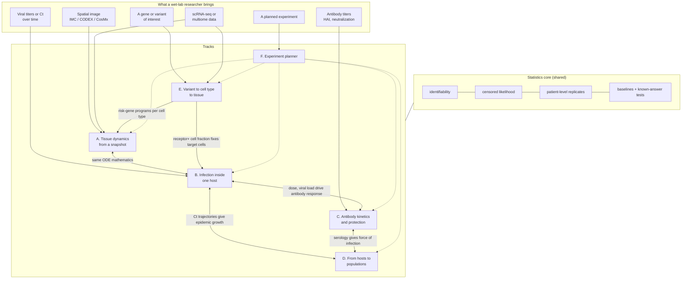

# Scope map: public databases, published methods and wet-lab questions

This project covers several connected tracks rather than one method. Every track uses the
same statistics core: identifiability before fitting, censored data handled as censored,
the patient as the unit of replication, a no-information baseline beside every result, and a
known-answer test before real data. What changes between tracks is the wet-lab question and
the public data used to answer it.

Items marked **(U)** were recalled rather than checked against the source. Each must be
verified before code depends on it.

## 1. The map

## 2. What joins the databases

Databases connect through shared identifiers. Most of those identifiers are ontologies.
Each join has a known way to go wrong, and the loader for each one checks for it.

| Key | Standard | Used by | Pitfall the loader checks |
|---|---|---|---|
| Gene | Ensembl gene ID (versioned), HGNC symbol | GTEx, gnomAD, CELLxGENE, TCGA, GWAS Catalog mapped genes | Symbols get renamed; an Ensembl version change can change the gene model. Join on ID and record the release |
| Variant | rsID, plus chromosome:position:ref:alt with genome build | GWAS Catalog, gnomAD, ClinVar, UCSC | GRCh37 and GRCh38 positions differ. Refuse a join when the builds disagree, rather than lifting over silently |
| Cell type | Cell Ontology (CL) IDs | CELLxGENE, HCA | Labels from different atlases are not interchangeable even when the names match. Keep each label's source |
| Tissue | UBERON | GTEx, CELLxGENE | GTEx tissue names are close to UBERON but not identical **(U)** |
| Disease or trait | EFO, MONDO | GWAS Catalog (EFO), Open Targets | A trait such as "QT interval" is not a diagnosis such as "long QT syndrome" |
| Patient or sample | Study-specific | Every cohort | **Never joined across datasets.** The same ID string in two studies is not the same person. Within one study, several cores or regions share a patient ID and are not independent |
| Pathogen strain | Strain name, sequence accession | Influenza HAI panels, GISAID | A strain name can hide different passage histories (egg- vs cell-grown) |

## 3. Tracks

Each track lists the bench question, the public data it connects, the published methods it
builds on, and what counts as validation. *Validation* means independent data not used for
fitting. *Annotation* means context that helps interpretation but cannot confirm a result.

### A. Tissue dynamics from a spatial snapshot

- **Bench question.** "My tissue image shows dividing cells. Can it tell me where this tissue is
  heading, and what extra marker would make that answer reliable?"
- **Public data.** Danenberg 2022 METABRIC IMC (Zenodo 7324285, open); Fischer 2023 IMC (Zenodo
  7494509, open); TCGA-BRCA and METABRIC bulk for translation.
- **Methods.** OSDR (Somer, *Nature* 2025); Voyager spatial statistics (Moses, bioRxiv 2023);
  neighbourhood "ecotypes" (Gulati, *Nat Rev MCB* 2024); optimal transport across time points
  (Bunne, *Nat Rev Methods Primers* 2024).
- **Biostatistics angle.** Patient-level inference instead of cell-level P values;
  leave-one-patient-out response prediction; compositional tests (scCODA, as in Chaffin 2022).
- **Validation.** A replication cohort (Fischer); survival in bulk cohorts via deconvolution;
  synthetic tissues with known dynamics.
- **Detail.** [roadmap.md](roadmap.md).

### B. Infection inside one host

- **Bench question.** "I measured viral load over time. Which parameters does my data actually
  pin down, and how should I treat samples below the detection limit?"
- **Public data.** Hayden 1996 influenza challenge (DSAIRM; 27 rows of **group daily averages
  digitised from a figure**, so it cannot support per-subject fitting); Kissler 2021 SARS-CoV-2 Ct
  (`gradlab/CtTrajectories`, **no license**); Beauchemin in vitro TCID50 (`cbeauc/mfm_ed_iv`);
  blood transcriptomes from respiratory challenge studies on GEO, e.g. GSE73072 **(U)**.
- **Methods.** DSAIRM (Handel, *BMC Immunol* 2020); identifiability review (Tuncer, *Curr Opin
  Syst Biol* 2025); profile likelihood (Simpson & Baker, *SIAM Rev* 2026); Bayesian workflow
  (Grinsztajn, *Stat Med* 2021).
- **Validation.** Predict the timing of the interferon response from a model fitted to viral
  load only, then check it against challenge-study transcriptomes the fit never saw.
- **Detail.** [notebook-design.md](notebook-design.md).

### C. Antibody kinetics and protection

- **Bench question.** "After vaccination or infection, how fast do titers rise and wane, and at
  what titer is someone protected?"
- **Public data.** Handel group HAI cohorts (`ahgroup/billings-*`, AGPL-3); CMI-PB prediction
  challenge **(U)**; ImmPort studies **(U)**.
- **Methods.** serosolver (Hay, *PLoS Comput Biol* 2020); titer-to-protection models (Khoury,
  *Nat Med* 2021); bias from substituting values below the detection limit (Handel group,
  *Vaccine* 2025); antigenic distance metrics (Billings, *PLoS Comput Biol* 2025).
- **Validation.** CMI-PB is a blind prediction challenge, so it is an independent validation
  by design.

### D. From hosts to populations

- **Bench question.** "Our surveillance lab reports Ct values. Can the distribution of Ct values
  on one day tell us whether the epidemic is growing?"
- **Public data.** Kissler Ct trajectories (within-host input); EPI-Eval surveillance series on
  Hugging Face; seroprevalence surveys.
- **Methods.** virosolver, epidemic growth from cross-sectional Ct (Hay, *Science* 2021); renewal
  models (CDC PyRenew); catalytic force-of-infection models (epiverse-trace serofoi).
- **Biostatistics and epidemiology angle.** A within-host model fitted in track B becomes the
  measurement model for population inference. Errors in B propagate into D, and this track
  quantifies how much.
- **Validation.** Compare the growth rate estimated from Ct against the growth rate from case
  counts in the same population and period.

### E. From a variant to a cell type to a tissue

- **Bench question.** "I study a gene or a variant. In which human cell types and tissues does it
  act, how constrained is it, and is my animal model consistent with human data?"
- **Public data.** GWAS Catalog, gnomAD, ClinVar, GTEx (expression and eQTL), Roadmap and ENCODE
  (chromatin state), UCSC Genome Browser (to view them together), CELLxGENE and the Human Protein
  Atlas (cell-type expression).
- **Methods.** Single-cell meta-analysis of SARS-CoV-2 entry genes, with donor-level checks and
  leave-one-dataset-out testing (Muus, *Nat Med* 2021); variant annotation with ClinVar and
  LOFTEE (Chaffin, *Nature* 2022); enhancer-level regulatory maps (Bravo González-Blas, *Nat Cell
  Biol* 2024); scoring cell types for GWAS signal (scDRS, S-LDSC) **(U)**.
- **Worked example: long QT syndrome type 2 (LQT2).** Singh et al. (*J Transl Med* 2025) report
  a KCNH2 knock-in rabbit with heart and brainstem phenotypes. From public data:
  - GTEx and the Human Protein Atlas test whether human KCNH2 is expressed in both heart and
    brain, an independent human check on the rabbit's two-organ phenotype.
  - Chaffin's human heart atlas (Single Cell Portal SCP1303) shows which cardiac cell types
    express it.
  - gnomAD gives KCNH2's loss-of-function constraint and carrier frequencies.
  - ClinVar lists its known pathogenic variants.
  - The GWAS Catalog lists QT-interval and epilepsy loci near KCNH2 **(U)**.
- **Epidemiology angle.** Combine gnomAD carrier frequency with the reported prevalence
  (1 in 2,000) to bound penetrance. Re-analyse the paper's own counts (seizures 7/37 vs 1/68;
  sudden death 18.9% vs 1.5%) as risk ratios with exact confidence intervals, and state the
  smallest effect those group sizes could detect.
- **Validation and annotation.** GTEx, the Human Protein Atlas and CELLxGENE can corroborate an
  expression claim. GWAS Catalog and gnomAD are annotation and prioritization, never
  confirmation of a mechanism.

### F. Experiment planner (connects every track)

- **Bench question.** "Before I spend the reagents, will this experiment answer my question?"
- **What it does.** It takes any fitted model from A–E, simulates the planned experiment with
  realistic noise and detection limits, refits each simulated dataset, and ranks alternative
  designs by how much they narrow the key uncertainty.
- **Examples.**
  - Track A: adding an apoptosis marker makes the death rate measurable instead of assumed.
  - Track B: an extra early sample narrows the infected-cell death rate. No sampling schedule
    of viral load alone can separate virion production from the target-cell count; that needs
    an independent measurement (bridge E → B).
  - Track C: one more late draw pins down the waning half-life.
- **Methods.** Simulation-based design; perturbation baselines from CPA (Lotfollahi, *Mol Syst
  Biol* 2023), where a linear baseline matched a deep model; simulated multi-omics ground truth
  (scMultiSim, *Nat Methods* 2025).

#### F1. Imaging-guided sampling: which regions should you sequence?

DISCO-seq (Bhatia et al., bioRxiv 2025, doi:10.64898/2025.12.10.693352) clears a whole organ or
mouse so it can be imaged in 3D *before* regions are chosen for sequencing, instead of picking
2D sections up front. Their glioblastoma design sequenced one tumour core and two anatomically
remote regions per animal, with n = 3 per condition and three regions pooled per sample.

That is a sampling design, and this track can evaluate it by simulation. Given a 3D map of where
a signal is (tumour cell density, protein deposition) and a budget of regions and animals:

- How many regions per animal, and placed where, before a region-specific effect is detectable?
- Does pooling regions within an animal lose the regional contrast the design was built to find?
- The replicate unit is the animal, not the region and never the cell. With n = 3 per condition,
  what effect size could the study detect at all? The paper reports a cell-type proportion shift
  (neurons 65% → 56% in the tumour core) with no stated uncertainty; recomputing it at the animal
  level is a worked example of this track's point.

**Why this fits here.** It needs no new biology and no restricted data — only a simulated signal
map, a sampling rule, and the same compare-designs machinery as the other examples.

#### F2. Out of scope

Named so they do not creep in. Each is real work; none of it is this project's work.

| Out of scope | Why |
|---|---|
| Tissue-clearing chemistry, RNA integrity, library optimisation | Wet-lab method development |
| 3D image processing: light-sheet acquisition, atlas registration, voxel-level segmentation | A large engineering effort of its own, not mechanistic modelling. This project takes a cell table as input |
| PET/CT co-registration with optical imaging | Imaging physics, a separate problem |
| Differential expression catalogues (which genes move in which cell type) | This project models dynamics and measurement; it is not a gene-discovery pipeline |
| Anything requiring raw 3D volumes | Terabyte-scale; not hostable here, and nothing is served from OneDrive |

The same boundary applies to any imaging modality: this project begins where a segmented,
phenotyped cell table with coordinates begins.

## 4. Bridges between tracks

These are specific studies that need two tracks at once. They are the most original parts of
the project.

| Bridge | Study | Why it is new |
|---|---|---|
| E → B | Use the fraction of receptor-positive airway cells (CELLxGENE, HPA, Muus 2021) to fix the starting target-cell count in the infection model | Viral load identifies only the product of virion production and target-cell count. An independent T0 turns that product into a production rate |
| B → D | Fit Ct trajectories (B), then use them as the measurement model for cross-sectional Ct epidemic inference (D) | Shows how within-host uncertainty propagates into population estimates |
| B → C | Relate inoculum dose and viral kinetics to antibody kinetics (norovirus dose studies from the Handel group) | Connects two literatures usually modelled separately |
| C → D | Feed fitted waning curves into force-of-infection models of serosurveys | Population immunity with antibody kinetics carried through |
| A ↔ B | One ODE and identifiability toolkit for tissue cell dynamics and infected-cell dynamics | Shows the core is general, not built for one dataset |
| E → A | Ask whether breast-cancer GWAS risk-gene programs concentrate in cell types whose division depends on neighbourhood | Links inherited risk to tissue dynamics. Annotation, clearly labelled as such |
| E (epi) | Penetrance bounds and properly powered re-analysis of animal-model counts | Biostatistics a wet-lab group can apply to its own published data |

## 5. Where a wet-lab researcher starts

| If you have | Start with | You get |
|---|---|---|
| A multiplexed tissue image with Ki67 | Track A | Neighbourhood-dependent division rates, with what can and cannot be concluded |
| Viral titers or Ct over time | Track B | Fitted parameters, which ones are identifiable, and censored samples handled correctly |
| Antibody titers before and after vaccination | Track C | Rise and waning rates, and a protection estimate with intervals |
| Surveillance Ct values | Track D | Epidemic growth estimate with propagated uncertainty |
| A gene, variant or animal model | Track E | A human-data dossier: expression by cell type and tissue, constraint, known variants, power of your own comparison |
| A plan, not data | Track F | Which design answers the question, and which extra measurement helps most |
| A 3D image and a sequencing budget | Track F1 | How many regions to sequence, where, and what your n can detect |

## 6. How it is built

Breadth comes from sharing one core, not from building six projects. The core is built
first. Each track is a module with its own config files, notebooks and release, and each is
complete on its own.

1. **Core** with synthetic known-answer tests. Everything else depends on it.
2. **Track B and Track A** come first. B has the smallest data and an existing design; A has the
   highest visibility.
3. **Track E** next. The databases are open and fast to query, and the LQT2 dossier is a
   self-contained, wet-lab-facing deliverable.
4. **Tracks C and D**, building on B.
5. **Track F** grows with each track, because every fitted model becomes a planner input.

